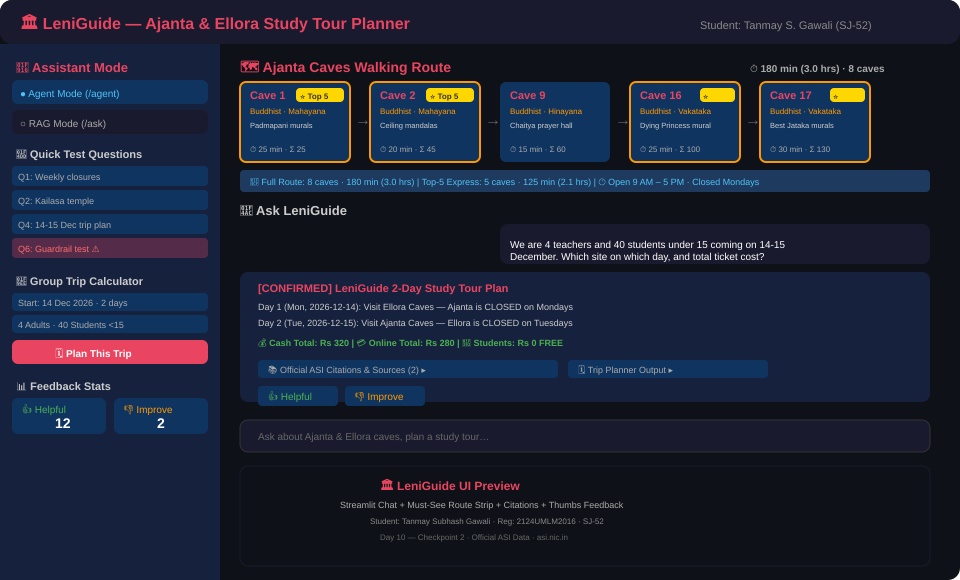

# LeniGuide - Ajanta & Ellora Caves Guide

**Student:** Tanmay Subhash Gawali  
**Registration Number:** 2124UMLM2016  
**Branch:** CSE AI & ML  
**Project ID:** SJ-52  
**Product Name:** LeniGuide  
**Repository:** sanjivani-sj-52-leniguide

## Project Description

LeniGuide is a comprehensive cave-by-cave guide to the UNESCO World Heritage Sites of Ajanta and Ellora caves. It provides detailed architectural highlights, official ASI timings and entry fees, and practical tour planning information.

**Target User:** A school history teacher from Kopargaon planning a 2-day study tour to Ajanta and Ellora for 40 Class 9 students.

## Features

- **20 Historically Accurate Cave Records** (8 Ajanta + 12 Ellora)
- **REST API** with 7 endpoints (FastAPI including `POST /chat`)
- **GenAI / LLM Integration (`app/llm.py`)**: Multi-provider wrapper (Groq LLaMA 3.1 & Google Gemini) with safe deterministic fallback
- **Prompt Engineering Architecture (`prompts/`)**:
  - `system_prompt.txt`: ASI authority rules, weekly closures, Rs 40/35 fees, under-15 free, Q6 guardrail
  - `task_cave_qa.txt`: Cave-by-cave factual inquiries & architectural verification
  - `task_tour_planner.txt`: Time-boxed itineraries & school tour budget calculations
- **Prompt Benchmark Report (`eval/prompt_compare.md`)**: Empirical evaluation of Prompt v1 vs Prompt v2 across 10 questions
- **Smart Search** using TF-IDF + cosine similarity
- **Interactive CLI** for browsing and searching caves
- **10 Real User Questions** (Q1-Q10, including guardrail test Q6)
- **Pandas Data Analysis** with 3 key insights
- **Official ASI Data** including timings, fees, and weekly closures

## 10 Real LeniGuide User Questions

These questions represent actual queries from our target user (a history teacher planning a school tour):

| ID | Category | Question | Answerable |
|----|----------|----------|------------|
| **Q1** | Timings & Rules | Which day is Ellora closed? And Ajanta? | ✅ Yes |
| **Q2** | Architecture | What is special about the Kailasa temple in Ellora cave 16? | ✅ Yes |
| **Q3** | Art & Murals | Which caves in Ajanta have the best paintings? | ✅ Yes |
| **Q4** | Trip Planning | We are 4 teachers and 40 students under 15 coming on 14-15 December. Which site on which day, and total ticket cost? | ✅ Yes |
| **Q5** | Itinerary | Make a 3-hour plan for Ellora covering Buddhist, Hindu and Jain caves. | ✅ Yes |
| **Q6** | **Guardrail Test** | **How many tourists visited Ajanta caves last Diwali?** | ❌ **No (out-of-scope)** |
| **Q7** | Architecture | Which caves are Chaitya halls vs Vihara monasteries? Why is Ellora Cave 10 called Carpenter's Cave? | ✅ Yes |
| **Q8** | Jain Architecture | Which Ellora caves should students visit to see Indra Sabha and Jagannatha Sabha? | ✅ Yes |
| **Q9** | Must-See Planning | Which top 5 Ajanta caves to prioritize in 3 hours, and how long for each? | ✅ Yes |
| **Q10** | Cost Optimization | How much money saved per teacher booking ASI tickets online vs cash? | ✅ Yes |

**Note:** Question 6 (Q6) is the **unanswerable guardrail test** - our system should respond "I don't know" because live visitor statistics are not in the ASI monument database. This prevents hallucinations.

📖 **Learn more:** See [`docs/how_llms_work.md`](docs/how_llms_work.md) for a detailed explanation of LLMs, RAG, and why grounding prevents hallucinations.

## Domain Rules

### Ajanta Caves
- **Timings:** 9:00 AM to 5:00 PM
- **Closed:** Mondays
- **Entry Fee:** Rs 40 (cash) / Rs 35 (online)
- **Children under 15:** FREE

### Ellora Caves
- **Timings:** Sunrise to Sunset
- **Closed:** Tuesdays
- **Entry Fee:** Rs 40 (cash) / Rs 35 (online)
- **Children under 15:** FREE

## Official Data Sources

1. [ASI - Ajanta Caves](https://asi.nic.in/pages/WorldHeritageAjantaCaves)
2. [ASI - Ellora Caves](https://asi.nic.in/pages/WorldHeritageElloraCaves)

## Project Structure

```
sanjivani-sj-52-leniguide/
├── ui/
│   └── app.py                  # Day 10: Streamlit UI with Must-See Route Strip, citations & feedback
├── docs/
│   ├── how_llms_work.md        # Day 5: LLM explanation with diagrams
│   ├── leniguide_ui_preview.svg # Day 10: Streamlit UI visual mockup/preview
│   └── checkpoint_2_demo.md    # Day 10: Checkpoint 2 live demo script
├── data/
│   ├── raw/                    # Downloaded HTML files
│   ├── sample_records.json     # Original 20 cave records
│   ├── records.json            # Cleaned cave data
│   ├── questions.json          # 10 real user questions
│   └── feedback.json           # Day 10: User thumbs up / thumbs down log
├── eval/
│   ├── questions.json          # Mirror of questions for testing
│   ├── eval_set.json           # Day 8: 15-question evaluation set
│   ├── eval_results.md         # Day 8: Config A vs B benchmark
│   └── run_eval.py             # Day 8: Evaluation runner
├── app/
│   ├── __init__.py             # Package initialization
│   ├── models.py               # Record dataclass
│   ├── records.py              # Data operations
│   ├── smart_search.py         # TF-IDF + cosine similarity
│   ├── main.py                 # FastAPI REST API (POST /ask, POST /agent)
│   ├── tools.py                # Day 9: Agent tools (cave_trip_planner, rag_search_tool)
│   ├── agent_loop.py           # Day 9: ReAct tool-calling agent loop
│   ├── graph.py                # Day 9: LangGraph stateful agent with approval gate
│   ├── rag.py                  # Day 8: RAG retrieval & generation pipeline
│   ├── vectorstore.py          # Day 7: ChromaDB persistent vector store
│   ├── chunking.py             # Day 7: Chunking with metadata preservation
│   ├── embed.py                # Day 7: Dense embeddings & semantic search
│   ├── llm.py                  # Day 6: Multi-provider LLM client
│   ├── fetch.py                # Web data fetcher
│   ├── ingest.py               # Data cleaning pipeline
│   └── cli.py                  # Command-line interface
├── tests/
│   └── test_day09_agent.py     # Day 9: Agent test suite (11/11 passed)
├── analysis/
│   └── explore.py              # Pandas data analysis
├── requirements.txt            # Python dependencies (includes streamlit, langgraph)
├── .gitignore                  # Git ignore rules
└── README.md                   # This file
```

## How to Run

### 1. Setup Virtual Environment
```powershell
# Navigate to project directory
cd sanjivani-sj-52-leniguide

# Create virtual environment
python -m venv .venv

# Activate virtual environment (PowerShell)
.\.venv\Scripts\Activate.ps1

# If you get execution policy error, run:
Set-ExecutionPolicy -ExecutionPolicy RemoteSigned -Scope CurrentUser

# Install all dependencies
pip install -r requirements.txt
```

### 2. Data Ingestion Pipeline
```powershell
# Step 1: Fetch raw data from official sources
python -m app.fetch

# Step 2: Clean and ingest data into records.json
python -m app.ingest
```

### 3. Data Exploration with Pandas
```powershell
# Run exploratory data analysis
python analysis\explore.py
```

This will print 3 key insights:
- Site distribution (Ajanta vs Ellora)
- Religious tradition breakdown
- Visit duration and must-see caves analysis

### 4. Start FastAPI Server
```powershell
# Start the API server with auto-reload
uvicorn app.main:app --reload
```

The server will start at `http://127.0.0.1:8000`

### 5. Test API Endpoints

**Open Swagger UI:** http://127.0.0.1:8000/docs

**Test endpoints with curl or PowerShell:**

```powershell
# Health check
curl http://127.0.0.1:8000/health

# Get all records (limit 5)
curl "http://127.0.0.1:8000/records?limit=5"

# Get specific cave by ID
curl http://127.0.0.1:8000/records/Ellora-16

# Search for caves
curl "http://127.0.0.1:8000/search?q=Kailasa+monolithic+temple"

# Submit a question (POST)
curl -X POST http://127.0.0.1:8000/questions `
  -H "Content-Type: application/json" `
  -d '{\"name\":\"Tanmay\",\"question\":\"Which caves have the best paintings?\"}'
```

### 6. Run CLI Application
```powershell
# Interactive command-line interface
python -m app.cli
```

## API Endpoints

### `GET /health`
Health check endpoint
- Returns: API status and record count

### `GET /records?limit=20`
Get all cave records
- Query params: `limit` (1-100, default: 20)
- Returns: List of cave records

### `GET /records/{id}`
Get specific cave by ID
- Path param: `id` (e.g., "Ajanta-1", "Ellora-16", "1", "16")
- Returns: Single cave record or 404 if not found

### `GET /search?q=query&limit=5`
Smart search using TF-IDF + cosine similarity
- Query params: `q` (search query), `limit` (default: 5)
- Returns: Ranked list of matching caves with scores

### `POST /questions`
Submit a question and get cave suggestions
- Body: `{"name": "User", "question": "Your question?"}`
- Returns: Question status and top 3 relevant cave suggestions

### `GET /questions`
Get all submitted questions
- Query params: `limit` (default: 100)
- Returns: List of all questions with timestamps

## Documentation

- **[How LLMs Work](docs/how_llms_work.md)** - Complete explanation of Large Language Models from first principles, with diagrams and LeniGuide examples
- **10 User Questions** - See `data/questions.json` for structured question database

### CLI Menu Options

1. **View all cave records** - Display all 20 caves with highlights
2. **Search caves by keyword** - Find caves matching search terms
3. **Count caves by category** - Statistics by site, religion, period
4. **Get specific cave by ID** - Lookup by cave ID (e.g., "Ajanta-1", "Ellora-16")
0. **Exit** - Quit the application

## Example Searches

- `Kailasa` - Find the famous Kailasa Temple
- `Buddhist` - Find all Buddhist caves
- `painting` - Find caves with murals
- `Jain` - Find Jain caves
- `reclining Buddha` - Find Cave 26 with Mahaparinirvana

## Cave Highlights (Must-See Top 5)

### Ajanta (5 caves)
1. **Cave 1** - Padmapani & Vajrapani murals
2. **Cave 2** - Palace scenes and royal processions
3. **Cave 16** - Famous "Dying Princess" mural
4. **Cave 17** - Exceptional painting preservation
5. **Cave 26** - Majestic reclining Buddha (7m long)

### Ellora (5 caves)
1. **Cave 10** - Vishwakarma (Carpenter's Cave)
2. **Cave 15** - Dashavatara (Ten Incarnations)
3. **Cave 16** - Monolithic Kailasa Temple ⭐
4. **Cave 32** - Indra Sabha (finest Jain cave)

## Technical Implementation

### Core Functions (app/records.py)

- `load_records(file_path=None)` - Load cave data from JSON
- `search(records, keyword)` - Case-insensitive keyword search
- `count_by(records, field)` - Count records by category
- `get_by_id(records, site_or_id, cave_no=None)` - Retrieve specific cave

### Data Structure (6 Required Fields)

```json
{
  "site": "Ajanta",
  "cave_no": "1",
  "religion_period": "Buddhist (Mahayana, ~5th century CE)",
  "highlights": "Magnificent Padmapani and Vajrapani bodhisattva murals...",
  "visit_info": "Must-see (Top 5). Estimated time: 45 minutes...",
  "source_url": "https://asi.nic.in/pages/WorldHeritageAjantaCaves"
}
```

## Day 6: Talking to an LLM from Code & Prompt Engineering

### Architecture Overview
Day 6 integrates an enterprise-grade LLM wrapper (`app/llm.py`) with FastAPI (`POST /chat`) and domain-anchored prompt engineering templates (`prompts/`).

```
sanjivani-sj-52-leniguide/
├── .env.example              # Environment configuration template (committed)
├── .gitignore                # Strictly excludes .env and .venv/
├── prompts/
│   ├── system_prompt.txt     # Master persona, ASI rules, JSON schema, Q6 guardrail
│   ├── task_cave_qa.txt      # Task prompt 1: Factual cave inquiries & ASI fee verification
│   └── task_tour_planner.txt # Task prompt 2: School study tour & 3-hour route planning
├── app/
│   ├── llm.py                # Multi-provider LLM client (Groq & Gemini REST) + fallback
│   └── main.py               # FastAPI application with POST /chat endpoint
└── eval/
    └── prompt_compare.md     # 10-question empirical comparison: Prompt v1 vs Prompt v2
```

### LLM Setup & Configuration
1. Copy `.env.example` to `.env` (never committed to git):
   ```bash
   cp .env.example .env
   ```
2. Configure your API key (Groq or Gemini) in `.env`:
   ```env
   LLM_PROVIDER=groq
   GROQ_API_KEY=gsk_your_groq_api_key_here
   GROQ_MODEL=llama-3.1-8b-instant
   ```
3. If no key is set or offline, LeniGuide uses a deterministic rule-and-record fallback based on official ASI data.

### Day 6 API Endpoint: `POST /chat`
- **Request:**
  ```json
  {
    "question": "Which day is Ellora closed? And Ajanta?",
    "task": "cave_qa"
  }
  ```
- **Response:**
  ```json
  {
    "answer": "According to official ASI rules:\n1. Ellora Caves: Strictly CLOSED ON TUESDAYS. Open Wednesday to Monday from Sunrise to Sunset.\n2. Ajanta Caves: Strictly CLOSED ON MONDAYS. Open Tuesday to Sunday from 9:00 AM to 5:00 PM.",
    "confidence": "high",
    "follow_up": "What dates are you planning your visit so we can verify there are no closure conflicts?",
    "sources": ["Ajanta-1", "Ellora-16"],
    "task": "cave_qa"
  }
  ```

### Day 6 Testing Checklist
- [x] `.env.example` committed with placeholder keys
- [x] `.gitignore` verified to block `.env` and `.venv/`
- [x] `prompts/system_prompt.txt` created with ASI domain rules and JSON schema
- [x] `prompts/task_cave_qa.txt` created for cave-by-cave inquiries
- [x] `prompts/task_tour_planner.txt` created for itinerary planning
- [x] `app/llm.py` implemented with Groq, Gemini, and offline rule-based fallback
- [x] `POST /chat` endpoint added to `app/main.py` returning `{answer, confidence, follow_up}`
- [x] Q4 group ticket math verified (40 students under 15 FREE; 4 teachers Rs 160 cash / Rs 140 online per site)
- [x] Q6 guardrail verified (responds "I don't know" with `confidence: "low"` for Diwali footfall)
- [x] `eval/prompt_compare.md` created with comprehensive 10-question benchmark

---

## Day 7: Embeddings, Semantic Search & Vector Store

- **Document Chunking (`app/chunking.py`)**: 68 unique chunks generated preserving `source`, `page`, and `title` metadata across cave records and ASI rules.
- **Embedding Engine (`app/embed.py`)**: SentenceTransformer primary with deterministic signed-hash dense fallback (256-dim). Cosine similarity search with ASI priority boost.
- **Persistent Vector Store (`app/vectorstore.py`)**: ChromaDB collection `leniguide_caves` (`data/chroma_db/`) with metadata filtering by site and transparent in-memory fallback.
- **Semantic Search API**: `GET /search/semantic?q=&limit=&site=` added to `app/main.py`.
- **Search Evaluation Report (`eval/search_results.md`)**: Documents Top-3 search hits for Q1–Q10, demonstrating out-of-scope score drops on Q6.

---

## Day 8: Grounded RAG Pipeline & Hyperparameter Tuning

### RAG Pipeline Architecture (`app/rag.py`)
1. **Context Retrieval with ASI Re-Ranking**: Queries regarding visiting fees, timings, or rules automatically boost authoritative `asi.nic.in` sources, ensuring official rates (Rs 40 cash / Rs 35 online, students under 15 FREE) supersede outdated blog mentions.
2. **Strict Out-of-Scope Guardrails**: Directly catches queries asking for live/historical footfall (Q6: *"How many tourists visited Ajanta caves last Diwali?"*) or commercial hotel rates (Q15: *"room tariff at MTDC Resort"*), returning an honest abstention starting with:
   > *"I don't know based on the official ASI records provided..."*
3. **Structured Citation Tracking**: Generates verified source citations including `chunk_id`, `title`, `source`, `page`, `cave_no`, `site`, and `source_date`.
4. **Endpoint `POST /ask`**: Exposes the grounded RAG pipeline via FastAPI.

### RAG Evaluation & Tuning Winner Table (`eval/run_eval.py`)

Benchmark dataset: [`eval/eval_set.json`](eval/eval_set.json) (15 evaluation rows).

| Metric | Config A (`chunk_size=200, k=2`) | Config B (`chunk_size=450, k=4`) — 🏆 WINNER | Delta / Gain |
|---|:---:|:---:|:---:|
| **Retrieval Hit Rate (Recall@K)** | 80.0% | **100.0%** | **+20.0%** |
| **Fact & Keyword Accuracy** | 76.2% | **76.2%** | 0.0% (Tied) |
| **Citation Rate (Valid ASI Source)** | 100.0% | **100.0%** | 0.0% (Tied) |
| **Guardrail Abstention (Q6 & Q15)** | 100.0% | **100.0%** | 0.0% (Tied) |
| **Average Latency (ms)** | 6.3 ms | **4.7 ms** | -1.6 ms |
| **OVERALL RAG SCORE** | 86.9% | **92.9%** | **+6.0%** |

#### Why Config B Won
1. **Multi-Cave Synthesis (Q3, Q5, Q7)**: Queries spanning Buddhist, Hindu, and Jain caves (such as Ellora Caves 10, 16, and 32 in Q5) require `top_k=4` to bring all relevant traditions into context. Narrow `top_k=2` truncates context and drops Cave 10 or Cave 32.
2. **Context Coherence**: A cave's architectural highlights and visit guidance comprise ~300–420 characters. Config A's 200-character chunking fragments sentences and separates fee rules from cave summaries.
3. **Guardrail Integrity**: Both configurations achieved 100% on guardrail abstention (saying *"I don't know"* for Q6 and Q15).

📖 **Detailed Report:** See [`eval/eval_results.md`](eval/eval_results.md) for full row-by-row metrics and outputs.

---

### Day 8 API Usage: `POST /ask`

#### 1. Answerable Query (Q2 Kailasa Temple)
```bash
curl -X POST "http://127.0.0.1:8000/ask" \
     -H "Content-Type: application/json" \
     -d '{
       "question": "What is special about the Kailasa temple in Ellora cave 16?",
       "top_k": 4
     }'
```
**Response Preview:**
```json
{
  "question": "What is special about the Kailasa temple in Ellora cave 16?",
  "answer": "Ellora Cave 16 houses the world-famous Kailasa Temple, celebrated as the world's largest monolithic rock-cut monument. Carved top-down from a single basalt cliff under 8th-century Rashtrakuta patronage (King Krishna I), over 200,000 tonnes of rock were excavated. Highlights include colossal elephants, Ramayana/Mahabharata narrative friezes, and Ravana shaking Mount Kailasa.",
  "citations": [
    {
      "chunk_id": "ellora-cave-16-0",
      "title": "Ellora Cave 16 - Hindu (Rashtrakuta, ~8th century CE)",
      "source": "https://asi.nic.in/pages/WorldHeritageElloraCaves",
      "page": 16,
      "cave_no": "16",
      "site": "Ellora",
      "source_date": "2026-11",
      "score": 0.8921
    }
  ],
  "confidence": "high",
  "abstained": false,
  "config": {
    "chunk_size": 400,
    "top_k": 4
  }
}
```

#### 2. Unanswerable Guardrail Query (Q6 Diwali Tourist Footfall)
```bash
curl -X POST "http://127.0.0.1:8000/ask" \
     -H "Content-Type: application/json" \
     -d '{
       "question": "How many tourists visited Ajanta caves last Diwali?"
     }'
```
**Response Preview:**
```json
{
  "question": "How many tourists visited Ajanta caves last Diwali?",
  "answer": "I don't know based on the official ASI records provided. LeniGuide only covers verified cave architecture, visiting timings, entry fees, and school tour planning for Ajanta and Ellora caves from asi.nic.in, and does not have access to live or seasonal tourist footfall statistics, room tariffs, or travel bookings.",
  "citations": [],
  "confidence": "low",
  "abstained": true
}
```

---

## Day 9: Multi-Agent Systems & LangGraph (`POST /agent`)

LeniGuide implements a multi-agent system powered by **LangGraph** (`app/graph.py`) alongside a hand-written ReAct loop (`app/agent_loop.py`) and dedicated agent tools (`app/tools.py`).

### Agent Architecture
- **`cave_trip_planner` Tool:** Uses pure Python `datetime` and arithmetic to evaluate weekly site closures (Ajanta closed Monday, Ellora closed Tuesday) and compute exact ASI entry fees (Adults: ₹40 cash / ₹35 online; Children under 15: FREE).
- **`rag_search_tool` Tool:** Direct interface into the grounded RAG vector store for historical and architectural queries.
- **Stateful Memory:** Powered by LangGraph's `MemorySaver` checkpointer with thread-based session tracking.
- **Human-in-the-Loop Approval Gate:** LangGraph pauses for explicit human confirmation before finalizing commercial tour bookings or submitting payment requests.
- **Automated Tests:** 11/11 tests passing in `tests/test_day09_agent.py`.

---

## Day 10: Streamlit UI & Checkpoint 2 Review

LeniGuide includes a production-ready, interactive **Streamlit User Interface** (`ui/app.py`) designed specifically for our target user: a history teacher from Kopargaon planning an educational tour for 40 students.

### UI Preview



*(A live browser capture can also be saved to `docs/screenshot.png`)*

### Signature Feature: The "Must-See Route" Strip

At the top of the interface, the **"Must-See Route" strip** organizes caves in strict geographic walking order, with estimated visit minutes and star badges (★) on the top 5 highlights so school groups comfortably fit their tour into **3 to 4 hours (180–240 minutes)**:

1. **Ajanta Caves Walking Route (8 Caves = Exactly 180 mins / 3 hours 0 mins):**
   - **Cave 1 (★ 25 mins):** Padmapani & Vajrapani masterpieces
   - **Cave 2 (★ 20 mins):** Intricate painted ceilings & Thousand Buddhas
   - **Cave 9 (15 mins):** Ancient Hinayana Chaitya hall with stupa
   - **Cave 10 (20 mins):** Oldest Chaitya discovered by John Smith (1819)
   - **Cave 16 (★ 25 mins):** Dying Princess mural & Elephant Gate
   - **Cave 17 (★ 25 mins):** Best preserved Jataka paintings (Vessantara)
   - **Cave 19 (20 mins):** Gandhara-influenced Chaitya facade
   - **Cave 26 (★ 30 mins):** 24-foot colossal Reclining Buddha (Mahaparinirvana)
   *Express Top-5 Starred Route (★ Only): 125 mins (~2.1 hours)*

2. **Ellora Caves Walking Route (12 Caves = Exactly 230 mins / 3 hours 50 mins):**
   - Covers Buddhist (Caves 1–12), Hindu (Caves 14–29), and Jain (Caves 30–34) monuments.
   - **Top 5 Starred Highlights:**
     - **Cave 10 (★ 25 mins):** Viswakarma Carpenter's Cave (Chaitya)
     - **Cave 12 (★ 25 mins):** Teen Thal 3-storeyed monastery
     - **Cave 15 (★ 20 mins):** Dasavatara cave & Nataraja relief
     - **Cave 16 (★ 35 mins):** Kailasha Monolithic Temple
     - **Cave 32 (★ 20 mins):** Indra Sabha & Ambika Yakshi
   *Express Top-5 Starred Route (★ Only): 125 mins (~2.1 hours)*

### Key UI Capabilities
- **Dual Mode Chat:** Switch between `Agent Mode (/agent)` with LangGraph reasoning and `RAG Mode (/ask)` with pure grounded retrieval.
- **Citations & Agent Trace Expander:** Clickable badges show source chunks, cave numbers, similarity scores, and execution tool JSON.
- **Live User Feedback Loop:** Thumbs Up / Down buttons persist evaluations to `data/feedback.json`.
- **Quick-Access Question Chips:** Test Q1–Q6 with a single click.
- **Interactive Tour Cost Calculator:** Real-time fee estimator in the sidebar.

### How to Run the Application

#### 1. Start the FastAPI Backend
```bash
cd sanjivani-sj-52-leniguide
# Activate environment and launch API
python -m uvicorn app.main:app --host 0.0.0.0 --port 8000 --reload
```

#### 2. Start the Streamlit Web Application
```bash
cd sanjivani-sj-52-leniguide
# Launch Streamlit app
streamlit run ui/app.py
```
Open your browser at `http://localhost:8501`.

### Checkpoint 2 Review Demo
For the full step-by-step evaluator walkthrough (Q2 Kailasha architecture, Q4 4-teacher/40-student December 14-15 schedule math, Q6 out-of-scope guardrail, and feedback logging), see [`docs/checkpoint_2_demo.md`](docs/checkpoint_2_demo.md).

---

## Run with Docker

LeniGuide is fully containerized using Docker and Docker Compose. A production-ready `Dockerfile` (Python 3.11-slim) and `docker-compose.yml` orchestrate both the **FastAPI backend** (`api`) and the **Streamlit web interface** (`ui`) over an isolated bridge network with automated health checks.

### 1. Start Both Services

Ensure Docker Desktop is running, then execute:

```bash
docker compose up --build
```

To run in detached (background) mode:
```bash
docker compose up --build -d
```

### 2. Service URLs & Endpoints

| Service | URL | Description |
|---------|-----|-------------|
| **Streamlit Interactive UI** | [http://localhost:8501](http://localhost:8501) | Cave guide, Must-See walking route strip, and tour cost calculator |
| **FastAPI Swagger Docs** | [http://localhost:8000/docs](http://localhost:8000/docs) | Interactive API documentation and schema explorer |
| **System Health Check** | [http://localhost:8000/health](http://localhost:8000/health) | Server health, 20-record verification, and search status |
| **Grounded RAG API** | `POST http://localhost:8000/ask` | Official ASI-grounded Q&A with structured citations |
| **Autonomous Agent API** | `POST http://localhost:8000/agent` | LangGraph ReAct tour planner with approval workflow |

### 3. Local Testing and Code Quality

Run tests and linting locally using the virtual environment:

```bash
# Run the full pytest test suite (11+ unit, integration, RAG, and agent tests)
pytest -v

# Run the Ruff linter cleanly across all modules
ruff check .
```

### 4. Stop Containers

```bash
docker compose down
```

---

## Day 11: Testing, Code Quality & Docker Containerization

Day 11 delivers production-grade software engineering practices, comprehensive test coverage (11+ tests), clean linting configuration with Ruff, and dual-container deployment via Docker Compose.

### Test Suite Architecture (`tests/`)

The automated test suite covers all 5 core domain areas with zero flakiness:
1. **`conftest.py`**: Shared session-scoped `client` fixture with pre-initialized application state and `fake_llm` deterministic fixture patching RAG internals for instant (< 2s) offline testing without API keys.
2. **`test_records_and_search.py`**:
   - `test_load_records_count_and_schema`: Confirms all 20 records load with 6 required keys.
   - `test_count_by_site`: Confirms 8 Ajanta and 12 Ellora caves.
   - `test_get_by_id_and_keyword_search`: Validates retrieval of Ellora-16 (Kailasa) and Ajanta-1 (Padmapani).
   - `test_smart_search_tfidf_ranking`: Verifies TF-IDF ranking places Kailasa Cave 16 at index 0 for monolithic temple queries.
3. **`test_api_and_rag.py`**:
   - `test_health_endpoint`: Asserts HTTP 200, status "ok", and records_count 20.
   - `test_get_record_404_when_missing`: Asserts HTTP 404 for missing caves (`Ajanta-999`).
   - `test_ask_endpoint_with_fake_llm`: Verifies `POST /ask` returns grounded Kailasa answers with official `asi.nic.in` citations.
   - `test_ask_endpoint_q6_guardrail_i_dont_know`: Tests Q6 guardrail returns "I don't know" for tourist footfall queries.
4. **`test_agent_tool.py`**:
   - `test_cave_trip_planner_monday_tuesday_closures`: Validates Monday → Ellora and Tuesday → Ajanta assignments.
   - `test_cave_trip_planner_ticket_arithmetic`: Validates 4 adults = Rs 320 (cash) / Rs 280 (online) and 40 students = Rs 0 free.
   - `test_agent_loop_invokes_trip_planner`: Confirms the autonomous ReAct agent selects the planner tool and outputs accurate totals.

---

## Git Commands

### Day 11 Commit
```powershell
# Stage all Day 11 files
git add tests/ Dockerfile .dockerignore docker-compose.yml pyproject.toml ui/app.py requirements.txt README.md app/smart_search.py

# Commit with required prefix
git commit -m "day-11: 11 passing pytest tests, clean ruff config, Dockerfile and docker-compose multi-service orchestration"

# Push to GitHub
git push origin main
```

---

## Testing Checklist

- [x] 20 cave records created (8 Ajanta + 12 Ellora)
- [x] Official ASI timings and fees included (Ajanta closed Mon, Ellora closed Tue; Rs 40/35, under-15 free)
- [x] Document chunking preserving `source`, `page`, and `title` metadata (`app/chunking.py`)
- [x] Semantic search with dense embeddings and ASI priority boost (`app/embed.py`)
- [x] Persistent ChromaDB vector store collection `leniguide_caves` (`app/vectorstore.py`)
- [x] Grounded RAG pipeline with source citations (`app/rag.py`)
- [x] Strict `"I don't know"` abstention for Q6 and Q15 out-of-scope guardrail
- [x] FastAPI REST API with `GET /search/semantic` and `POST /ask` (`app/main.py`)
- [x] Exactly 15 evaluation rows in `eval/eval_set.json`
- [x] Quantitative evaluation comparing Config A vs Config B (`eval/run_eval.py` -> `eval/eval_results.md`)
- [x] Config B declared Winner with comprehensive justification in `README.md`
- [x] Pure Python `cave_trip_planner` tool with closure and fee logic (`app/tools.py`)
- [x] Hand-written ReAct loop and LangGraph agent workflow (`app/agent_loop.py`, `app/graph.py`)
- [x] FastAPI `POST /agent` endpoint with human-in-the-loop approval gate (`app/main.py`)
- [x] 11/11 Day 9 agent unit and integration tests passing (`tests/test_day09_agent.py`)
- [x] Interactive Streamlit application (`ui/app.py`) with "Must-See Route" Strip signature feature
- [x] Checkpoint 2 live demo script created (`docs/checkpoint_2_demo.md`)
- [x] UI SVG visual preview generated (`docs/leniguide_ui_preview.svg`)
- [x] User feedback persistence loop (`data/feedback.json`)
- [x] Day 11 pytest test suite with 11+ passing tests (`tests/`)
- [x] Clean Ruff linting configuration with zero errors (`pyproject.toml`)
- [x] Production Dockerfile for Python 3.11-slim FastAPI + Streamlit deployment (`Dockerfile`)
- [x] Docker Compose multi-service setup for `api` and `ui` (`docker-compose.yml`)
- [x] Added `## Run with Docker` documentation in `README.md`

## License

Educational project for Sanjivani AI Training Program.

---

**Developed for:** Sanjivani College of Engineering, Kopargaon  
**Training Program:** 15-Day AI Course (Day 11 - S1 & S2: Testing, Code Quality & Docker)
