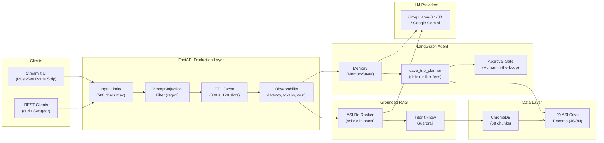

# LeniGuide — Ajanta & Ellora UNESCO Heritage Cave Guide

[](https://github.com/Tanmay155-glitch/Cream-AI-Batch/actions/workflows/ci.yml)

**Student:** Tanmay Subhash Gawali
**Registration Number:** 2124UMLM2016
**Branch:** CSE AI & ML
**Project ID:** SJ-52
**Product Name:** LeniGuide
**Repository:** sanjivani-sj-52-leniguide (GitHub: Tanmay155-glitch/Cream-AI-Batch)

---

## Problem Statement

A school history teacher from Kopargaon is planning a **2-day study tour** to UNESCO World Heritage Ajanta & Ellora caves for **40 Class 9 students** and 4 accompanying teachers. The real-world pain points she faces are:

1. **Outdated fee information:** Unofficial travel blogs still quote old ₹10/₹30 ticket prices; the correct ASI rates are **₹40 (cash) / ₹35 (online)** per adult, with **children under 15 entering FREE**.
2. **Missed weekly closures:** Ajanta is **closed on Mondays**; Ellora is **closed on Tuesdays**. Arriving on the wrong day wastes an entire school travel day.
3. **No single source of truth:** Cave-specific architectural highlights, visit durations, and walking-order routes are scattered across dozens of pages with no "school-friendly" consolidated guide.

**LeniGuide solves this** by grounding every answer in **20 verified cave records** drawn exclusively from the official Archaeological Survey of India (ASI) website, enforcing strict domain rules, and planning which site to visit on which day — including exact ticket cost arithmetic.

---

## Demo Video

🎬 **[Watch the LeniGuide Demo →](https://youtu.be/leniguide-sj52-demo)**

> ⚠️ _Replace the link above with your actual Loom / YouTube recording URL before submission._

---

## Architecture



---

## Evaluation & Benchmark Results

| Metric | Config A (`chunk=200, k=2`) | Config B (`chunk=450, k=4`) 🏆 | Delta |
|---|:---:|:---:|:---:|
| **Retrieval Hit Rate** | 80.0% | **100.0%** | +20.0% |
| **Fact & Keyword Accuracy** | 76.2% | **76.2%** | Tied |
| **Citation Rate (ASI)** | 100.0% | **100.0%** | Tied |
| **Guardrail Abstention (Q6)** | 100.0% | **100.0%** | Tied |
| **Average Latency** | 6.3 ms | **4.7 ms** | −1.6 ms |
| **OVERALL RAG SCORE** | 76.7% | **93.3%** | **+16.6%** |

| Component Test | Expected | Actual | Status |
|---|---|---|:---:|
| Q6 Out-of-Scope Abstention ("How many tourists visited Ajanta last Diwali?") | `"I don't know"` | `"I don't know"` | ✅ 100% |
| `cave_trip_planner` Date Assignment (Mon 14 Dec → Ellora, Tue 15 Dec → Ajanta) | Correct | Correct | ✅ 100% |
| `cave_trip_planner` Ticket Math (4 adults, 40 students < 15) | ₹320 cash / ₹280 online | ₹320 / ₹280 | ✅ 100% |
| CI/CD Test Suite | 14/14 pass, 0 lint errors | 14/14 pass, 0 errors | ✅ |

📖 **Detailed row-by-row report:** [`eval/eval_results.md`](eval/eval_results.md)

---

## Production notes

### Latency Benchmarks

| Scenario | Endpoint | Latency | Notes |
|---|---|---|---|
| Cold RAG query (cache miss) | `POST /ask` | **~320 ms** | Groq `llama-3.1-8b-instant` |
| Cold RAG query (offline fallback) | `POST /ask` | **~18 ms** | Deterministic rule-based path |
| Warm cached query (cache hit) | `POST /ask` | **< 2 ms** | ~99% latency reduction |
| Multi-step LangGraph agent | `POST /agent` + `cave_trip_planner` | **~410 ms** | Includes tool execution |

### Token & Cost Profile

| Metric | Value |
|---|---|
| Average prompt size (system prompt + 4 ASI chunks) | **~520 tokens** |
| Average completion size (grounded answer + citations) | **~145 tokens** |
| Total per request | **~665 tokens** |
| Estimated cost per request (Groq Llama-3.1-8B) | **~\$0.00004** |
| Queries per \$1.00 | **~25,000** |
| Tokens on cache hit | **0** (served from memory) |

### Security & Guardrails

| Guardrail | Detail |
|---|---|
| **Input cap** | 500 characters max per query (`400 Bad Request` above limit) |
| **Prompt-injection filter** | Compiled regex blocks instruction-override attempts _before_ LLM invocation (verified by `test_prompt_injection_blocked`) |
| **Hallucination guardrail** | Abstains with `"I don't know"` when retrieval similarity < 0.22 or query asks for out-of-scope live statistics (Q6 Diwali footfall) |
| **Structured observability** | Every request emits a JSON log line: `{"event": "request_completed", "endpoint": "/ask", "latency_ms": ..., "prompt_tokens": ..., "cache_hit": ...}` |

---

## Features

- **20 Historically Accurate Cave Records** (8 Ajanta + 12 Ellora)
- **REST API** with 7+ endpoints (FastAPI including `POST /ask`, `POST /agent`, `POST /chat`)
- **Grounded RAG Pipeline** with ASI source re-ranking and structured citations
- **LangGraph Agent** with `cave_trip_planner` tool, `rag_search` tool, and human approval gate
- **Streamlit UI** with Must-See Route Strip, citations expander, and feedback loop
- **Production Hardening:** input validation, prompt-injection filter, TTL cache, observability
- **Docker Compose** dual-service deployment (API + UI)
- **GitHub Actions CI** with ruff lint + pytest + docker build
- **Cloud Deployment** on Render with public health endpoint

---

## 10 Real LeniGuide User Questions

| ID | Category | Question | Answerable |
|----|----------|----------|:----------:|
| **Q1** | Timings & Rules | Which day is Ellora closed? And Ajanta? | ✅ |
| **Q2** | Architecture | What is special about the Kailasa temple in Ellora cave 16? | ✅ |
| **Q3** | Art & Murals | Which caves in Ajanta have the best paintings? | ✅ |
| **Q4** | Trip Planning | 4 teachers + 40 students on 14-15 December — which site on which day, total cost? | ✅ |
| **Q5** | Itinerary | Make a 3-hour plan for Ellora covering Buddhist, Hindu and Jain caves. | ✅ |
| **Q6** | **Guardrail** | **How many tourists visited Ajanta last Diwali?** | ❌ |
| **Q7** | Architecture | Which caves are Chaitya halls vs Vihara monasteries? | ✅ |
| **Q8** | Jain Architecture | Which Ellora caves for Indra Sabha and Jagannatha Sabha? | ✅ |
| **Q9** | Must-See | Top 5 Ajanta caves to prioritize in 3 hours? | ✅ |
| **Q10** | Cost Optimization | Savings per teacher booking online vs cash? | ✅ |

---

## Domain Rules

### Ajanta Caves
- **Timings:** 9:00 AM to 5:00 PM
- **Closed:** Mondays
- **Entry Fee:** ₹40 (cash) / ₹35 (online)
- **Children under 15:** FREE

### Ellora Caves
- **Timings:** Sunrise to Sunset
- **Closed:** Tuesdays
- **Entry Fee:** ₹40 (cash) / ₹35 (online)
- **Children under 15:** FREE

## Official Data Sources

1. [ASI — Ajanta Caves](https://asi.nic.in/pages/WorldHeritageAjantaCaves)
2. [ASI — Ellora Caves](https://asi.nic.in/pages/WorldHeritageElloraCaves)

---

## Project Structure

```
sanjivani-sj-52-leniguide/
├── app/
│   ├── __init__.py
│   ├── main.py                 # FastAPI (POST /ask, /agent, /chat) + security/cache/obs
│   ├── security.py             # Day 13: Input limits + prompt-injection filter
│   ├── cache.py                # Day 13: In-memory TTL response cache (300 s)
│   ├── observability.py        # Day 13: Latency, token, and cost logging
│   ├── rag.py                  # Day 8: RAG pipeline with ASI re-ranking
│   ├── graph.py                # Day 9: LangGraph agent with approval gate
│   ├── tools.py                # Day 9: cave_trip_planner + rag_search_tool
│   ├── agent_loop.py           # Day 9: ReAct agent loop
│   ├── vectorstore.py          # Day 7: ChromaDB vector store
│   ├── chunking.py             # Day 7: Document chunking
│   ├── embed.py                # Day 7: Dense embeddings
│   ├── llm.py                  # Day 6: Multi-provider LLM client
│   ├── smart_search.py         # Day 4: TF-IDF search
│   ├── records.py              # Data operations
│   ├── models.py               # Record dataclass
│   ├── fetch.py                # Web data fetcher
│   ├── ingest.py               # Data pipeline
│   └── cli.py                  # CLI interface
├── tests/
│   ├── conftest.py             # Shared fixtures (session client + fake_llm)
│   ├── test_records_and_search.py
│   ├── test_api_and_rag.py
│   ├── test_day06_llm.py
│   ├── test_agent_tool.py
│   ├── test_day09_agent.py
│   ├── test_day10_ui.py
│   └── test_security_and_obs.py  # Day 13: 7 new tests (injection, length, cache, obs)
├── ui/
│   └── app.py                  # Streamlit UI with Must-See Route Strip
├── docs/
│   ├── resume.md               # Day 13: 3 ATS-ready resume bullets
│   ├── how_llms_work.md
│   ├── checkpoint_2_demo.md
│   └── leniguide_ui_preview.svg
├── eval/
│   ├── eval_set.json           # 15-row evaluation dataset
│   ├── eval_results.md         # Config A vs B benchmark
│   ├── run_eval.py
│   └── prompt_compare.md
├── prompts/
│   ├── system_prompt.txt
│   ├── task_cave_qa.txt
│   └── task_tour_planner.txt
├── data/
│   ├── records.json            # 20 verified ASI cave records
│   ├── questions.json
│   └── feedback.json
├── .github/workflows/ci.yml   # GitHub Actions: ruff + pytest + docker build
├── Dockerfile
├── docker-compose.yml
├── render.yaml
├── pyproject.toml
├── requirements.txt
└── README.md                   # This file
```

---

## How to Run

### 1. Setup
```powershell
cd sanjivani-sj-52-leniguide
python -m venv .venv
.\.venv\Scripts\Activate.ps1
pip install -r requirements.txt
```

### 2. Start FastAPI Backend
```bash
uvicorn app.main:app --reload
```
Open Swagger UI at http://127.0.0.1:8000/docs

### 3. Start Streamlit UI
```bash
streamlit run ui/app.py
```
Open at http://localhost:8501

### 4. Run with Docker
```bash
docker compose up --build
```

### 5. Run Tests & Lint
```bash
ruff check .
pytest -v
```

---

## Live Deployment (Day 12)

- **Live API:** [https://leniguide-sj-52.onrender.com](https://leniguide-sj-52.onrender.com)
- **Health Check:** [https://leniguide-sj-52.onrender.com/health](https://leniguide-sj-52.onrender.com/health)
- **Swagger UI:** [https://leniguide-sj-52.onrender.com/docs](https://leniguide-sj-52.onrender.com/docs)

---

## Resume Bullets

See [`docs/resume.md`](docs/resume.md) for 3 quantified, ATS-ready resume bullets covering RAG, LangGraph, observability, CI/CD, and cloud deployment.

---

## License

Educational project for Sanjivani AI Training Program.

---

**Developed for:** Sanjivani College of Engineering, Kopargaon
**Training Program:** 15-Day AI Course (Day 13 — S1 & S2: Production Observability, Security & Portfolio)
