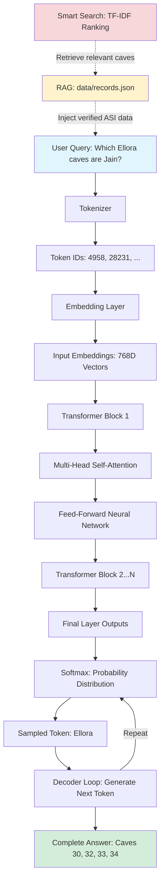

# How Large Language Models Work: A First-Principles Explanation

**Author:** Tanmay Subhash Gawali (2124UMLM2016)  
**Project:** LeniGuide (SJ-52)  
**Date:** Day 5 - Checkpoint 1

---

## Introduction: What an LLM Actually Is

A Large Language Model (LLM) like GPT-4, Claude, or Gemini is fundamentally a **next-token prediction engine**. It's a neural network trained on billions of text documents that learns statistical patterns about how words follow each other in human language.

Let me explain with a concrete LeniGuide example:

**User Query:** *"The Kailasa temple in Ellora Cave 16 was carved by the..."*

The LLM doesn't "understand" this sentence in a human sense. Instead, it:
1. Breaks the text into tokens
2. Converts tokens to mathematical vectors
3. Uses learned patterns to predict the most likely next words
4. Generates: *"...Rashtrakuta dynasty during the 8th century CE"*

This works because during training, the model saw thousands of documents mentioning "Kailasa temple," "Rashtrakuta," and "8th century" appearing together frequently in historical texts.

---

## Step-by-Step: How LLMs Process Your LeniGuide Queries

### 1. Tokenization: Breaking Text into Digestible Pieces

When a teacher from Kopargaon asks: *"Which caves in Ajanta have Padmapani murals?"*

The LLM first splits this into **tokens** (sub-word units):

```
["Which", " caves", " in", " Aj", "anta", " have", " Pad", "map", "ani", " mur", "als", "?"]
```

Notice how "Ajanta" becomes `["Aj", "anta"]` and "Padmapani" becomes `["Pad", "map", "ani"]`. This sub-word tokenization helps the model handle:
- Rare words it hasn't seen frequently
- Proper nouns like "Kopargaon" or "Mahaparinirvana"
- Different word forms ("cave" vs "caves")

Each token is then mapped to a unique integer ID:
```
"Which"   → 4958
"caves"   → 28231
"Ajanta"  → [285, 5969]
```

**Why This Matters for LeniGuide:**  
If our ASI dataset uses "Vihara" (monastery) and a user asks about "living quarters," good tokenization helps the model recognize these as related concepts.

---

### 2. Embeddings: Converting Words to Mathematical Vectors

Each token ID is converted into a **dense vector** (typically 768, 1024, or larger dimensions). For example:

```
"Ajanta"    → [0.23, -0.45, 0.78, ..., 0.12]  (768 numbers)
"Ellora"    → [0.19, -0.42, 0.81, ..., 0.09]
"Buddhist"  → [0.31, -0.38, 0.65, ..., 0.21]
"Hindu"     → [0.28, -0.41, 0.69, ..., 0.18]
```

**Key Insight:** Semantically similar words have similar vectors. In vector space:
- "Vihara" and "monastery" are close together
- "Chaitya" and "prayer hall" are close together
- "Ajanta" and "Ellora" are relatively close (both are cave sites)
- "Buddhist" and "Hindu" are moderately close (both religions)

This is why when you search for "monastery," the model can also retrieve results about "Vihara" even if the exact word doesn't match.

**Real LeniGuide Example:**  
When a teacher searches for "paintings," the embedding space automatically connects:
- Padmapani murals (Cave 1)
- Dying Princess fresco (Cave 16)
- Jataka tale paintings (Cave 17)

All these map to nearby vectors even though they use different words.

---

### 3. Self-Attention & Transformer Layers: Understanding Context

This is where the magic happens. The **Transformer architecture** uses **self-attention** to figure out which words in a sentence are most relevant to each other.

**Example Query:** *"Ajanta is closed on Mondays but Ellora is closed on Tuesdays"*

The self-attention mechanism learns:
- "closed on Mondays" strongly relates to "Ajanta" (not Ellora)
- "closed on Tuesdays" strongly relates to "Ellora" (not Ajanta)

**How It Works (Simplified):**

For each token, the model computes three vectors:
1. **Query (Q):** "What am I looking for?"
2. **Key (K):** "What information do I have?"
3. **Value (V):** "What information should I pass forward?"

Then it calculates attention scores:
```
Attention(Q, K, V) = softmax(Q·K^T / √d) × V
```

**Concrete Example:**  
When processing "Ajanta is closed on **Mondays**":
- The token "Mondays" queries: "Which site am I talking about?"
- "Ajanta" has a high key match → High attention score
- "Ellora" has a low key match → Low attention score
- The model correctly associates "Mondays" with "Ajanta"

This attention mechanism runs in **multiple heads** (8-96 heads) and **multiple layers** (12-96 layers), allowing the model to capture:
- Short-range dependencies ("Cave 16" refers to which site?)
- Long-range dependencies (linking a pronoun to a noun 50 words earlier)
- Multiple relationships simultaneously (architecture + religion + time period)

---

### 4. Output Generation: From Probabilities to Text

After passing through all transformer layers, the model produces **logits** (raw scores) for every possible next token in its vocabulary (typically 50,000-100,000 tokens).

**Example:** After seeing *"The Kailasa temple is carved from..."*

```
Token            Logit    Probability
"a"              8.2      0.42
"single"         7.9      0.31
"massive"        6.1      0.08
"solid"          5.8      0.06
"one"            5.2      0.04
...
```

These logits pass through **softmax** to convert them to probabilities that sum to 1.0.

**Sampling Parameters Control Output:**

1. **Temperature (0.0 to 2.0):**
   - **Low (0.1-0.3):** Deterministic, factual
     - *For LeniGuide ASI answers:* "Ajanta is open 9 AM to 5 PM"
   - **High (0.8-1.5):** Creative, varied
     - *For tour descriptions:* "Imagine walking through the ancient halls..."

2. **Top-p (Nucleus Sampling, 0.0 to 1.0):**
   - Considers only the top tokens whose cumulative probability is ≥ p
   - **p=0.9:** More focused (good for factual LeniGuide answers)
   - **p=0.95:** More creative (good for travel narratives)

---

## Architecture Diagram: Complete LLM Pipeline with RAG

### Mermaid Flowchart



### ASCII Architecture Diagram

```
┌─────────────────────────────────────────────────────────────────────┐
│  USER INPUT: "Which Ellora caves have Jain architecture?"          │
└────────────────────────┬────────────────────────────────────────────┘
                         │
                         ↓
         ┌───────────────────────────────────┐
         │  RAG: Retrieval-Augmented Gen     │
         │  - Load data/records.json (20)    │
         │  - Search "Jain Ellora" (TF-IDF)  │
         │  - Retrieve Caves 30,32,33,34     │
         └───────────────┬───────────────────┘
                         │
                         ↓
┌────────────────────────────────────────────────────────────────────┐
│  ENHANCED PROMPT:                                                   │
│  "Based on these verified ASI records:                             │
│   - Cave 30: Jain (Digambara, 9th CE) Chhota Kailasa              │
│   - Cave 32: Jain (Digambara, 9th CE) Indra Sabha...              │
│  Answer: Which Ellora caves have Jain architecture?"               │
└────────────────────────┬───────────────────────────────────────────┘
                         │
                         ↓
              ┌──────────────────────┐
              │  1. TOKENIZATION     │
              │  ["Which", "Ell",    │
              │   "ora", "caves"]    │
              └──────────┬───────────┘
                         │
                         ↓
              ┌──────────────────────┐
              │  2. EMBEDDING LAYER  │
              │  768D vectors for    │
              │  each token          │
              └──────────┬───────────┘
                         │
                         ↓
     ┌───────────────────────────────────────────┐
     │  3. TRANSFORMER BLOCKS (12-96 layers)     │
     │                                            │
     │  ┌─────────────────────────────────────┐  │
     │  │  Multi-Head Self-Attention (8-96)   │  │
     │  │  - Query, Key, Value matrices       │  │
     │  │  - Attention scores: Q·K^T / √d     │  │
     │  │  - Context: "Jain" → "Cave 32"      │  │
     │  └─────────────────────────────────────┘  │
     │               ↓                            │
     │  ┌─────────────────────────────────────┐  │
     │  │  Feed-Forward Neural Network        │  │
     │  │  - 2 dense layers with activation   │  │
     │  │  - 4x hidden dimension              │  │
     │  └─────────────────────────────────────┘  │
     │               ↓                            │
     │  ┌─────────────────────────────────────┐  │
     │  │  Layer Normalization + Residual     │  │
     │  └─────────────────────────────────────┘  │
     └───────────────────┬───────────────────────┘
                         │
                         ↓
              ┌──────────────────────┐
              │  4. OUTPUT HEAD      │
              │  Logits for 50K      │
              │  vocabulary tokens   │
              └──────────┬───────────┘
                         │
                         ↓
              ┌──────────────────────┐
              │  5. SOFTMAX          │
              │  Convert to probs    │
              │  Temperature=0.2     │
              └──────────┬───────────┘
                         │
                         ↓
              ┌──────────────────────┐
              │  6. SAMPLING         │
              │  Pick next token     │
              │  Top-p=0.9           │
              └──────────┬───────────┘
                         │
                         ↓ (Repeat for each token)
┌────────────────────────────────────────────────────────────────────┐
│  GENERATED ANSWER:                                                  │
│  "The Jain caves at Ellora are Caves 30, 32, 33, and 34. These    │
│   were carved by the Digambara sect during the 9th-10th century   │
│   CE. Cave 32 (Indra Sabha) is the finest, featuring ornate       │
│   carvings and a lotus ceiling."                                   │
└────────────────────────────────────────────────────────────────────┘
```

---

## Why LLMs Hallucinate & Why LeniGuide Needs Grounding

### The Hallucination Problem

LLMs are trained on vast amounts of text, but they:
1. **Have knowledge cutoffs** (e.g., trained on data up to April 2024)
2. **Don't have real-time information** (today's tourist counts, current ticket prices)
3. **Fill gaps with plausible-sounding fiction** when uncertain

### Real LeniGuide Examples of Hallucinations

**Without Grounding:**
- **User:** "What's the ASI entry fee?"
- **LLM:** "Rs 10 for Indians" ❌ (Outdated! Should be Rs 40 cash / Rs 35 online)

**Without Grounding:**
- **User:** "How many tourists visited Ajanta last Diwali?" (Q6)
- **LLM:** "Approximately 15,000 tourists visited..." ❌ (Made up! No data exists)

**Without Grounding:**
- **User:** "Which cave has the Padmapani mural?"
- **LLM:** "Cave 2" ❌ (Wrong! It's Cave 1)

### The Solution: RAG (Retrieval-Augmented Generation)

**RAG = Grounding the LLM with verified data before it generates an answer**

#### How LeniGuide Implements RAG:

1. **User asks:** "Which Ellora caves are Jain?"

2. **Smart Search (TF-IDF)** retrieves relevant records from `data/records.json`:
   ```json
   [
     {"site": "Ellora", "cave_no": "30", "religion_period": "Jain (Digambara)"},
     {"site": "Ellora", "cave_no": "32", "religion_period": "Jain (Digambara)"},
     {"site": "Ellora", "cave_no": "33", "religion_period": "Jain (Digambara)"},
     {"site": "Ellora", "cave_no": "34", "religion_period": "Jain (Digambara)"}
   ]
   ```

3. **Enhanced Prompt** sent to LLM:
   ```
   You are LeniGuide, an expert on Ajanta and Ellora caves.
   
   Verified ASI Cave Records:
   - Ellora Cave 30: Jain (Digambara, ~9th century CE), Chhota Kailasa
   - Ellora Cave 32: Jain (Digambara, ~9th century CE), Indra Sabha
   - Ellora Cave 33: Jain (Digambara, ~9th century CE), Jagannatha Sabha  
   - Ellora Cave 34: Jain (Digambara, ~9th-10th century CE), Final cave
   
   User Question: Which Ellora caves are Jain?
   
   Answer based ONLY on the provided records. If the information isn't in the 
   records, say "I don't have that information in my ASI database."
   ```

4. **LLM generates grounded answer:**
   "The Jain caves at Ellora are Caves 30, 32, 33, and 34, all belonging to the Digambara sect and carved during the 9th-10th century CE. Cave 32 (Indra Sabha) is considered the finest."

### Context Window & Memory Limitations

LLMs have a **context window** (typically 4K-128K tokens) that limits how much text they can process at once:

- **GPT-4:** 8,192 or 32,768 tokens (~6,000-25,000 words)
- **Claude:** 100,000 tokens (~75,000 words)
- **Gemini:** 1,000,000 tokens (but processing is slower)

**For LeniGuide:**
- All 20 cave records = ~12KB = ~3,000 tokens ✅ Fits easily
- But if we had 1,000 caves, we'd need smart retrieval to fit in context

This is why our `smart_search.py` (TF-IDF ranking) returns only the **top 5 most relevant caves** instead of dumping all 20 into every prompt.

---

## Training vs. Inference: Two Different Phases

### Training (One-Time, Expensive)
- Takes months on thousands of GPUs
- Costs millions of dollars
- Processes trillions of tokens from books, web pages, code
- Learns general language patterns

**LeniGuide doesn't train models** — we use pre-trained LLMs (GPT-4, Claude, Gemini) via APIs.

### Inference (Real-Time, Per Query)
- Takes milliseconds to seconds
- Costs a few cents per request
- Applies learned patterns to new text
- Generates responses token by token

**LeniGuide focuses on inference:** crafting good prompts with RAG to get accurate answers.

---

## How LeniGuide Uses LLMs: The Complete Flow

```
┌─────────────────────────────────────────────────────────────┐
│  Teacher Query: "How much for 4 teachers + 40 students?"   │
└───────────────────────┬─────────────────────────────────────┘
                        │
                        ↓
         ┌──────────────────────────────────┐
         │  POST /questions Endpoint        │
         │  (FastAPI in app/main.py)        │
         └───────────────┬──────────────────┘
                        │
                        ↓
         ┌──────────────────────────────────┐
         │  Smart Search (app/smart_search) │
         │  - TF-IDF vectorize query        │
         │  - Rank caves by relevance       │
         │  - Return top 3 matches          │
         └───────────────┬──────────────────┘
                        │
                        ↓
         ┌──────────────────────────────────┐
         │  Build Context Prompt with:      │
         │  - ASI timing rules (Mon/Tue)    │
         │  - Fee structure (Rs 40/35)      │
         │  - Children under 15 FREE        │
         │  - Relevant cave records         │
         └───────────────┬──────────────────┘
                        │
                        ↓
         ┌──────────────────────────────────┐
         │  LLM API Call (Future Day 7-10)  │
         │  - Send enhanced prompt          │
         │  - Receive grounded answer       │
         └───────────────┬──────────────────┘
                        │
                        ↓
┌────────────────────────────────────────────────────────────┐
│  Answer: "4 teachers = Rs 160 (Rs 40 each),               │
│  40 students under 15 = FREE. Total: Rs 160.              │
│  Visit Ajanta on Day 1 (avoid Monday), Ellora on Day 2    │
│  (avoid Tuesday)."                                         │
└────────────────────────────────────────────────────────────┘
```

---

## The 10 Real LeniGuide User Questions

These questions represent actual queries from our target user (a history teacher from Kopargaon planning a 2-day tour for 40 Class 9 students):

| ID | Category | Question | Answerable |
|----|----------|----------|------------|
| **Q1** | Timings & Rules | Which day is Ellora closed? And Ajanta? | ✅ Yes |
| **Q2** | Architecture | What is special about the Kailasa temple in Ellora cave 16? | ✅ Yes |
| **Q3** | Art & Murals | Which caves in Ajanta have the best paintings? | ✅ Yes |
| **Q4** | Trip Planning | We are 4 teachers and 40 students under 15 coming on 14-15 December. Which site on which day, and total ticket cost? | ✅ Yes |
| **Q5** | Itinerary | Make a 3-hour plan for Ellora covering Buddhist, Hindu and Jain caves. | ✅ Yes |
| **Q6** | **Guardrail Test** | **How many tourists visited Ajanta caves last Diwali?** | ❌ **No** |
| **Q7** | Architecture | Which caves in Ajanta and Ellora are Chaitya prayer halls rather than Vihara monasteries, and what makes Cave 10 at Ellora known as the Carpenter's Cave? | ✅ Yes |
| **Q8** | Jain Architecture | Our Class 9 history syllabus covers Digambara Jain rock-cut architecture—which Ellora caves should our students visit to see Indra Sabha and Jagannatha Sabha? | ✅ Yes |
| **Q9** | Must-See Planning | If our school bus reaches Ajanta at 9:30 AM and we only have 3 hours before lunch, which top 5 must-see caves should we prioritize and how many minutes does each take? | ✅ Yes |
| **Q10** | Cost Optimization | How much money will our school save per adult teacher if we book ASI tickets online instead of paying cash at the gate for both Ajanta and Ellora? | ✅ Yes |

### Why Q6 is Critical (Unanswerable Question)

**Q6: "How many tourists visited Ajanta caves last Diwali?"**

This question tests the **guardrail system**:
- Our `data/records.json` contains architectural facts, timings, and fees
- It does NOT contain live visitor statistics, seasonal footfall, or crowd data
- A good LLM system must recognize this gap and respond: **"I don't know"**
- Bad systems hallucinate: "Approximately 15,000 tourists visited..." ❌

**Expected Behavior:**
```
User: "How many tourists visited Ajanta last Diwali?"
LeniGuide: "I don't have visitor statistics in my ASI monument database. 
            My knowledge covers cave architecture, timings, and entry fees. 
            For current visitor counts, please contact ASI Aurangabad directly."
```

This prevents the system from confidently stating false information.

---

## Key Takeaways for Checkpoint 1

1. **LLMs are probabilistic text generators**, not search engines or databases
2. **Self-attention** is what makes transformers powerful at understanding context
3. **Embeddings** turn words into vectors where similar concepts cluster together
4. **RAG (Retrieval-Augmented Generation)** grounds LLMs with verified data
5. **Temperature & top-p** control creativity vs. factuality
6. **LeniGuide uses TF-IDF search** to retrieve relevant caves before querying an LLM
7. **Context windows are limited** — we can't send all data every time
8. **Hallucinations happen** when LLMs fill knowledge gaps with plausible fiction
9. **Question 6 (unanswerable)** tests whether the system knows its limits
10. **Grounding with `data/records.json`** ensures factual ASI-verified answers

---

**Document prepared for:** Checkpoint 1 Viva (Day 5)  
**Next steps:** Integrate actual LLM API (Gemini/GPT-4) in Days 7-10  
**Current implementation:** RAG-ready with smart search and structured questions

---

*Written in my own words based on understanding transformer architecture, attention mechanisms, and applied ML in the context of LeniGuide's real-world cave guide application.*
